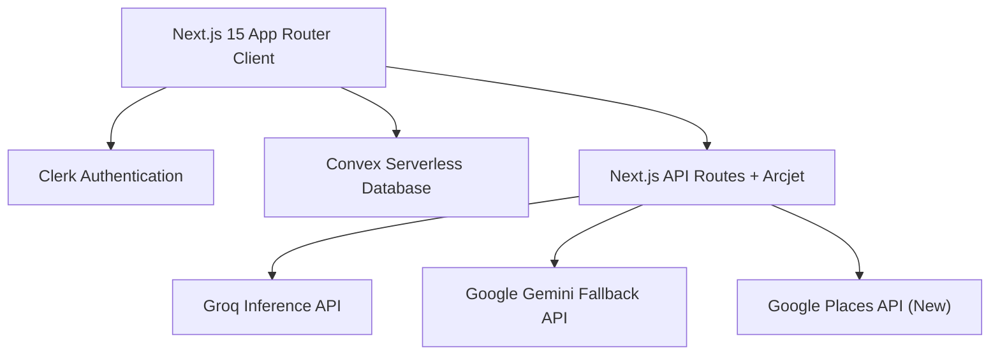

# Software Requirements Specification (SRS)
## SkyTrip — AI-Powered Personalized Travel Planner & Trip Companion

---

## 1. Introduction

### 1.1 Purpose & Problem Alignment
**SkyTrip** addresses the fragmented nature of modern trip planning. Instead of forcing users to combine separate tools for itinerary creation, hotel discovery, spatial route mapping, currency conversion, timezone management, and packing preparation, SkyTrip consolidates the entire travel lifecycle into a single accessible, AI-driven web application.

### 1.2 Scope & Core Objectives
1. **Conversational Trip Synthesis**: Gather traveler origin, destination, group size, budget tier, duration, interests, and accessibility requirements step-by-step and output strict, geo-verified JSON itineraries.
2. **Spatial Map Visualization**: Render hotels, numbered daily stops, sequential day polylines (`Hotel → Activities → Hotel`), and nearby essential categories (`Restaurants`, `ATMs`, `Hospitals`, `Metro`, `EV Charging`, `Fuel`, `Shopping`, `Washrooms`).
3. **Resilient Multi-Model AI Pipeline**: Prioritize low-latency Groq inference (`openai/gpt-oss-20b`) with automated JSON extraction/recovery (`extractJsonPayload`) and Google Gemini (`gemini-2.5-flash` / `gemini-1.5-flash`) fallback.
4. **Offline-Capable Companion Utilities**: Provide live currency conversion (with static fallback rates), IANA timezone offset comparisons, sociable hour warnings, local events, and printable QR-coded PDF guides.
5. **Security, Accessibility & Testability**: Enforce Clerk route protection, Arcjet token-bucket rate limiting, HTTP security headers, WCAG 2.1 AA accessibility landmarks/ARIA roles, and automated Vitest test coverage.

---

## 2. System Architecture

### 2.1 Frontend
- **Framework**: Next.js 15 (App Router) & React 19
- **Language**: TypeScript (`strict: true`)
- **Styling**: Tailwind CSS v4 with `:focus-visible` and `prefers-reduced-motion` accessibility rules
- **Maps**: `@react-google-maps/api` with Google Places API (New) support
- **Animations & Feedback**: `motion/react`, `lucide-react`, `sonner`

### 2.2 Backend, Security & Persistence
- **Database**: Convex (`UserTable` and `TripDetailTable`)
- **Authentication**: Clerk middleware (`middleware.ts`) protecting private planner, dashboard, and user trip routes
- **Rate Limiting**: Arcjet token bucket (`lib/arcjet.ts`) on AI generation, trip-addon, and contact endpoints
- **Security Headers**: `X-Content-Type-Options`, `X-Frame-Options`, `Referrer-Policy`, and `Permissions-Policy` configured in `next.config.ts`

---

## 3. Database Schema (`convex/schema.ts`)

- **`UserTable`**:
  - `name`: `v.string()`
  - `imageUrl`: `v.string()`
  - `email`: `v.string()`
  - `subscription`: `v.optional(v.string())` (`free`, `pro`, `globetrotter`)
  - `aiCredits`: `v.optional(v.number())` (3 initial starter credits on registration)
- **`TripDetailTable`**:
  - `tripId`: `v.string()`
  - `tripDetail`: `v.any()` (hotels, itinerary, coordinates, budget, accessibility notes)
  - `uid`: `v.id("UserTable")`
  - `completed`: `v.optional(v.boolean())`
  - `feedback`: `v.optional(v.any())`
  - `companionData`: `v.optional(v.any())` (cached currency, timezone, recommendations, and events)

---

## 4. Verification & Testing Strategy

All shared domain logic, API handlers, and interactive UI controls are validated with **Vitest**, **jsdom**, and **React Testing Library**:
- `__tests__/travel-utils.test.ts`: Location detection, currency conversion, timezone offsets, Haversine distance, trip cost aggregation, and Google Flights URL builders.
- `__tests__/ai-helpers.test.ts`: LLM JSON recovery, UI widget inference, message sanitization, and contact form input validation.
- `__tests__/api-routes.test.ts`: Route handler integration tests (`/api/health`, `/api/contact`, `/api/chat`, `/api/google-place-detail`).
- `__tests__/components.test.tsx`: Accessible component interactions (`aria-pressed`, disabled states, keyboard controls, destination-aware packing lists).

Run `npm run typecheck`, `npm run lint`, `npm test`, and `npm run build` to verify full production readiness.
